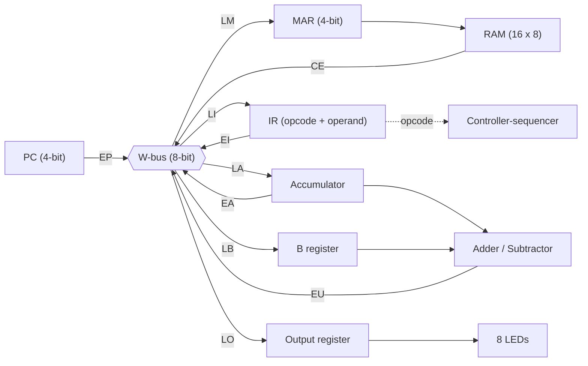

# SAP-1 Architecture Simulator
A browser-based simulator of the **SAP-1 (Simple-As-Possible 1)** computer. Load a short program, then step through it one clock pulse at a time and watch data move across the W-bus between the PC, MAR, RAM, IR, accumulator, B register, adder/subtractor and output register, with the T1–T6 control signals lighting up as they fire.

## Features

- **Complete SAP-1 datapath**: 16×8 RAM, 4-bit PC and MAR, 8-bit IR split into opcode and operand nibbles, accumulator, B register, adder/subtractor (subtraction by 2’s complement) and an 8-bit output register.
- **Controller-sequencer**: a six-state ring counter (T1–T6) with every control signal (EP, LM, CE, LI, …) shown as it is asserted.
- **Live W-bus**: the 8 bus bits, a `source → destination` label, and amber (drives the bus) or green (loads from the bus) highlighting on each register.
- **RAM viewer**: binary, hex and disassembly for all 16 addresses, with the PC arrow, the MAR row and the row being read highlighted.
- **Output LEDs**: 8 LEDs plus hex and decimal readout.
- **Load Program panel**: a small assembler with line-numbered error messages.
- **Controls**: Step (one T-state), Step instruction, Run/Pause until `HLT`, Reset and a 1–20 Hz clock slider.
- **Responsive, light and dark themes** that follow the system setting.

## Architecture



The controller-sequencer decodes the opcode in IR and asserts the control signals listed under [Timing](#timing).

## Getting started

No dependencies to install. The code uses ES modules, which browsers block on `file://` URLs, so the folder must be served over http.

```bash
git clone <repo-url>
cd sap1-simulator
code .
```

**VS Code (recommended):** accept the prompt to install the recommended **Live Server** extension (`ritwickdey.LiveServer`), then right-click `index.html` and choose **Open with Live Server** (or click **Go Live** in the status bar).

**Without VS Code:**

```bash
npm start                      # Node.js 18+, serves http://localhost:3000
python -m http.server 8000     # serves http://localhost:8000
```

## Usage

| Control | What it does |
|---|---|
| Load into RAM | Assembles the program text into RAM and resets the CPU |
| Test case | Restores the verification program and loads it |
| Step (one T-state) | Fires a single clock pulse |
| Step instruction | Runs pulses until the next fetch begins |
| Run / Pause | Clocks automatically until `HLT` |
| Reset | Clears every register and the ring counter, and restores the last loaded program |
| Clock slider | Sets the Run speed from 1 to 20 Hz |

### Program format

```
; comment
LDA 9      ; instruction with a hex address 0-F (an H suffix is accepted)
ADD A
OUT        ; OUT and HLT take no operand
HLT
9: 25      ; data line, ADDR: value (a hex byte, or 8 binary digits)
```

Instructions are placed at consecutive addresses starting at 0H. OUT and HLT are stored with `F` in the lower nibble. A program and its data must fit in 16 locations.

## Instruction set

| Mnemonic | Opcode | Action |
|---|---|---|
| `LDA a` | `0000` | A ← RAM[a] |
| `ADD a` | `0001` | B ← RAM[a]; A ← A + B |
| `SUB a` | `0010` | B ← RAM[a]; A ← A + NOT B + 1 (2’s complement) |
| `OUT` | `1110` | Output ← A |
| `HLT` | `1111` | Stop the clock |

A machine word is the opcode (upper nibble) followed by the operand (lower nibble).

## Timing

**Fetch cycle (every instruction)**

| T-state | Signals | Transfer |
|---|---|---|
| T1 | `EP`, `LM` | PC → MAR |
| T2 | `CP` | PC ← PC + 1 |
| T3 | `CE`, `LI` | RAM[MAR] → IR |

**Execute cycle**

| Instruction | T4 | T5 | T6 |
|---|---|---|---|
| LDA | `EI`, `LM` | `CE`, `LA` | none |
| ADD | `EI`, `LM` | `CE`, `LB` | `EU`, `LA` |
| SUB | `EI`, `LM` | `CE`, `LB` | `SU`, `EU`, `LA` |
| OUT | `EA`, `LO` | none | none |
| HLT | `HLT` | none | none |

**Control signals**

| Signal | Meaning |
|---|---|
| `EP`, `EI`, `CE`, `EA`, `EU` | Enable PC, IR operand, RAM, accumulator or adder/subtractor onto the W-bus |
| `LM`, `LI`, `LA`, `LB`, `LO` | Load MAR, IR, accumulator, B register or output register from the W-bus |
| `CP` | Count: increment the PC |
| `SU` | Subtract: the adder/subtractor computes A + NOT B + 1 |
| `HLT` | Halt the clock |

## Verification test

Computes `25H + 05H − 23H`. Press **Test case** to load it.

| Address | Content | Binary | Hex |
|---|---|---|---|
| 0H | `LDA 9H` | `0000 1001` | `09` |
| 1H | `ADD AH` | `0001 1010` | `1A` |
| 2H | `SUB BH` | `0010 1011` | `2B` |
| 3H | `OUT` | `1110 1111` | `EF` |
| 4H | `HLT` | `1111 1111` | `FF` |
| 9H | data | `0010 0101` | `25` |
| AH | data | `0000 0101` | `05` |
| BH | data | `0010 0011` | `23` |

| After | A | B | Output |
|---|---|---|---|
| `LDA 9H` | `25H` | `00H` | `00H` |
| `ADD AH` | `2AH` | `05H` | `00H` |
| `SUB BH` | `07H` | `23H` | `00H` |
| `OUT` | `07H` | `23H` | `07H` (`0000 0111`) |

The subtraction is 2AH + NOT 23H + 1 = 2AH + DCH + 1 = 107H, and the carry out of 8 bits is discarded, leaving `07H`.

## Project structure

```
sap1-simulator/
├── index.html                page markup
├── css/styles.css            layout, light/dark themes, register glow, LEDs
├── js/
│   ├── isa.js                opcodes, mnemonics, hex/binary helpers
│   ├── sequencer.js          ring counter (T1-T6) and control words
│   ├── cpu.js                CPU state, adder/subtractor, clockPulse() (no DOM access)
│   ├── assembler.js          program text to RAM image, default test program
│   ├── view.js               draws registers, RAM, W-bus, sequencer and LEDs
│   └── main.js               buttons, Run timer, clock-speed slider
├── .vscode/extensions.json   recommends the Live Server extension
├── package.json              optional `npm start` static server
└── README.md
```

## Design notes

- **One module per hardware block**: `sequencer.js`, `cpu.js` and `assembler.js` map to the controller, datapath and loader.
- **DOM-free core**: `cpu.js` is plain state plus one transition function (`clockPulse`), so it can be unit-tested in Node or moved into React/TypeScript unchanged.
- **No build step**: plain HTML, CSS and ES2020 modules, so there is nothing to install or bundle.

## Deploy to GitHub Pages

1. Push the project to a GitHub repository.
2. Open **Settings → Pages** (under *Code and automation*).
3. Under *Build and deployment*, set **Source** to **Deploy from a branch**, choose `main` and `/ (root)`, and click **Save**.
4. After a minute or two the simulator is live at `https://<username>.github.io/<repository>/`.

## Scope and limitations

- Only the five SAP-1 instructions are implemented: there are no jumps, stores or flags, as in the original SAP-1.
- RAM is 16 bytes and is not written during execution, so **Reset** restores the last *loaded* program rather than unloaded editor changes.
- A word whose opcode is not one of the five runs as a no-op after its fetch cycle.

## Author
Godwyn Dave E. Sebastian

## Acknowledgments

The SAP-1 architecture is from Albert Paul Malvino’s *Digital Computer Electronics*.
